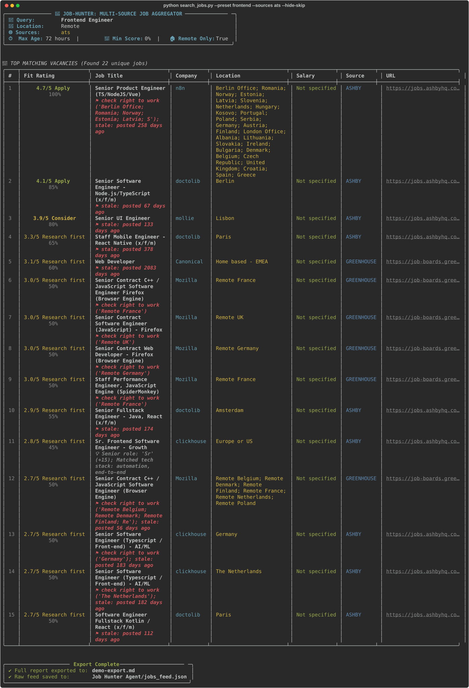
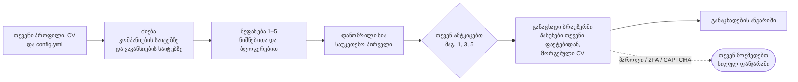

<div align="center">

# Job-Hunter

**თქვენი AI ასისტენტი სამუშაოს საძიებლად. პოულობს ვაკანსიებს თქვენი პროფესიისთვის, აფასებს თითოეულს თქვენს პროფილთან შედარებით და განაცხადს აგზავნის მხოლოდ იმ ვაკანსიებზე, რომლებსაც თქვენ დაამტკიცებთ. ყველაფერი თქვენს კომპიუტერზე მუშაობს.**

[](https://github.com/lasha-kvara/Job-Hunter/actions/workflows/tests.yml)
[](CHANGELOG.md)
[](https://www.python.org/downloads/)
[](https://claude.com/claude-code)
[](#installation)
[](LICENSE)

[English version](README.md) · **ქართული**

[შესაძლებლობები](#features) · [როგორ მუშაობს](#how-it-works) · [ინსტალაცია](#installation) · [ყოველი დაბრუნებისას](#every-time-you-come-back) · [პირველი ძიება](#first-search-and-first-application) · [ბრძანების ხაზი](#command-line-no-ai) · [ხშირი კითხვები](#faq) · [დოკუმენტაცია](#documentation)

</div>

ერთხელ აღწერთ საკუთარ თავს: თქვენს პროფილს, CV-ს და სად შეგიძლიათ მუშაობა. ამის შემდეგ Job-Hunter ათვალიერებს კომპანიების კარიერის გვერდებსა და ვაკანსიების საიტებს, თითოეულ ვაკანსიას აფასებს 1-დან 5-მდე და გაჩვენებთ დანომრილ მოკლე სიას (shortlist). ის ავსებს და აგზავნის **მხოლოდ თქვენ მიერ დამტკიცებულ განაცხადებს** და ინახავს ანგარიშს ყველაფერზე, რაც გაგზავნა. მეორე აგენტი კითხულობს რეკრუტერების შეტყობინებებს LinkedIn-ზე, ამზადებს პასუხების მონახაზებს თქვენი დასამტკიცებლად და გასაუბრებებს თქვენს დროის სარტყელში ნიშნავს.

ის მუშაობს [Claude Code](https://claude.com/claude-code)-ში, თქვენსავე კომპიუტერზე. ძიება და შეფასება ჩვეულებრივ Python-საც შეუძლია, AI ანგარიშის გარეშე.

<details>
<summary><b>ნახეთ რეალური ძიება</b> (ტერმინალის გამონატანი)</summary>
<br>
<p align="center">
  
</p>
</details>

---

<a id="features"></a>

## შესაძლებლობები

| | |
|---|---|
| **ნებისმიერი პროფესია** | 11 მზა პრესეტი: QA automation, frontend, backend, full-stack, mobile, DevOps, data engineer, data analyst, ML engineer, product designer და product manager. შეგიძლიათ საკუთარიც დაამატოთ. [პრესეტები →](presets/README.md) |
| **ნებისმიერი ქვეყანა** | უთითებთ, სად ცხოვრობთ და რომელი რეგიონებისთვის შეგიძლიათ მუშაობა. ვაკანსიები, რომლებსაც ვერასდროს აიღებთ, იფილტრება: დისტანციური როლები მხოლოდ აშშ-სთვის ("US only"), როლები, რომლებიც security clearance-ს მოითხოვს, ადგილზე სამუშაო საზღვარგარეთ რელოკაციის გარეშე. |
| **~200 კომპანიის საიტი** | პირდაპირ კითხულობს Greenhouse-ს, Ashby-ს, Lever-ს, SmartRecruiters-სა და Recruitee-ს (შესვლის გარეშე, CAPTCHA-ს გარეშე, დაახლოებით 30 წამში). ასევე ეძებს LinkedIn-ზე, Indeed-ზე, Glassdoor-ზე, ZipRecruiter-ზე, Google Jobs-სა და jobs.ge-ზე. |
| **გულწრფელი შეფასება 1–5** | თითოეული ვაკანსია იღებს ვერდიქტს: Apply, Consider, Research first ან Skip. ნიშნები აღნიშნავს დამაბრკოლებელ ფაქტორებს და ძველ, ხელახლა გამოქვეყნებულ ან ბუნდოვან განცხადებებს. |
| **CV თითოეული ვაკანსიისთვის** | თქვენი მთავარი (master) CV თითოეული ვაკანსიისთვის გადალაგდება და გადაიწერება, შემდეგ კი მოწმდება master-თან, რომ ახალი ფაქტები არ გაჩნდეს. მიიღებთ დიზაინიან PDF-ს და ATS-თან თავსებად PDF-ს. [CV-ის გზამკვლევი →](docs/cv.md) |
| **რეკრუტერების ასისტენტი** | კითხულობს LinkedIn-ის მიმოწერებს, პასუხების მონახაზებს ამზადებს რეკრუტერის ენაზე და გასაუბრების დროს გთავაზობთ თქვენს დროის სარტყელში. აგზავნის მხოლოდ იმას, რასაც თქვენ დაამტკიცებთ. |
| **კონტროლი თქვენს ხელშია** | თქვენი დამტკიცების გარეშე არაფერი იგზავნება. პაროლებს, 2FA კოდებს, CAPTCHA-სა და ონლაინ ტესტებს ყოველთვის თქვენ თავად აკეთებთ. |
| **გამოგონილი პასუხების გარეშე** | აგენტი პასუხობს მხოლოდ იმ ფაქტებით, რომლებიც თქვენ ჩაწერეთ. თუ ფორმა ისეთ რამეს ითხოვს, რაც არ აქვს, გეკითხებათ. არასდროს ვარაუდობს. |
| **კონფიდენციალური ნაგულისხმევად** | თქვენი პროფილი, CV, პარამეტრები და ისტორია თქვენს დისკზე რჩება და Git მათ უგულებელყოფს. არანაირი ტელემეტრია, არანაირი Job-Hunter სერვერი. [კონფიდენციალურობა →](docs/privacy.md) |

<a id="how-it-works"></a>

## როგორ მუშაობს



| ვერდიქტი | შეფასება | მნიშვნელობა |
|---|---|---|
| **Apply** (გაგზავნა) | 4.0 ან მეტი | კარგად შეესაბამება, ბლოკერების გარეშე |
| **Consider** (განიხილეთ) | 3.5 – 3.9 | შეესაბამება, გარკვეული ხარვეზებით |
| **Research first** (ჯერ გადაამოწმეთ) | 2.5 – 3.4 | ლოკაცია, ტექნოლოგიები ან სანდოობა ბუნდოვანია |
| **Skip** (გამოტოვება) | 2.5-ზე ნაკლები, ან ბლოკერი | სიაში არ ჩანს |

**ბლოკერები:** დისტანციური სამუშაო, რომელიც შეზღუდულია რეგიონებით, სადაც მუშაობა არ შეგიძლიათ; სავალდებულო სამუშაო ნებართვა ან security clearance; ადგილზე სამუშაო საზღვარგარეთ რელოკაციის გარეშე; ან ვაკანსია, რომელზეც უკვე გაგზავნეთ განაცხადი. ძველი, ხელახლა გამოქვეყნებული ან ძალიან ბუნდოვანი განცხადებები ქულებს კარგავს. სრული წესები: [scoring.md](.claude/skills/job-hunter-agent/references/scoring.md).

---

## სწრაფი დაწყება

უკვე გაქვთ დაყენებული Python 3.10+, Git, Node.js 18+ და Claude Code? მაშინ (macOS-სა და Linux-ზე `python`-ის ნაცვლად გამოიყენეთ `python3`):

```bash
git clone https://github.com/lasha-kvara/Job-Hunter.git
cd Job-Hunter
python init.py
claude
```

Claude Code-ში დაწერეთ **"set up my profile"** (ჩემი პროფილის მომზადება). ტერმინალთან მუშაობა ახალია თქვენთვის? მიჰყევით ქვემოთ მოცემულ ნაბიჯ-ნაბიჯ [ინსტალაციას](#installation).

<a id="installation"></a>

## ინსტალაცია

> [!NOTE]
> **დაახლოებით 15–20 წუთი, მხოლოდ ერთხელ.** პროგრამირების ცოდნა არ გჭირდებათ. ტერმინალში რამდენიმე ბრძანებას აკრეფთ. ტერმინალი არის ტექსტური ფანჯარა, სადაც ბრძანებებს წერთ. დააკოპირეთ თითოეული ბრძანება ზუსტად ისე, როგორც წერია, და დააჭირეთ <kbd>Enter</kbd>-ს.

<details>
<summary><b>როგორ გავხსნა და გამოვიყენო ტერმინალი?</b></summary>

- **Windows:** დააჭირეთ <kbd>Win</kbd>-ს, აკრიფეთ `PowerShell` და დააჭირეთ <kbd>Enter</kbd>-ს. Windows Terminal-იც გამოდგება.
- **macOS:** დააჭირეთ <kbd>Cmd</kbd> + <kbd>Space</kbd>-ს, აკრიფეთ `Terminal` და დააჭირეთ <kbd>Enter</kbd>-ს.
- **Linux:** დააჭირეთ <kbd>Ctrl</kbd> + <kbd>Alt</kbd> + <kbd>T</kbd>-ს, ან გახსენით "Terminal" აპლიკაციების მენიუდან.

ბრძანების **ჩასასმელად** დააჭირეთ <kbd>Ctrl</kbd> + <kbd>V</kbd>-ს, ან, თუ არაფერი მოხდა, მაუსის მარჯვენა ღილაკს (macOS: <kbd>Cmd</kbd> + <kbd>V</kbd>). მიმდინარე ბრძანების **შესაჩერებლად** დააჭირეთ <kbd>Ctrl</kbd> + <kbd>C</kbd>-ს. Claude Code-იდან **გამოსასვლელად** აკრიფეთ `/exit`.

</details>

### ნაბიჯი 1 · დააყენეთ საჭირო პროგრამები

| პროგრამა | ვერსია | რისთვის გჭირდებათ | ჩამოტვირთვა |
|---|---|---|---|
| **Python** | 3.10 ან უფრო ახალი | უშვებს დაყენების, ძიებისა და შეფასების სკრიპტებს | [python.org/downloads](https://www.python.org/downloads/) |
| **Git** | ნებისმიერი ახალი | ჩამოტვირთავს Job-Hunter-ს და ინახავს მას განახლებულად. Claude Code-იც იყენებს | [git-scm.com/downloads](https://git-scm.com/downloads) |
| **Node.js** | 18 ან უფრო ახალი (LTS) | უშვებს ბრაუზერს, რომლითაც Claude Code ფორმებს ავსებს | [nodejs.org](https://nodejs.org/) |
| **Claude Code** | უახლესი | AI აგენტი, რომელიც ეძებს ვაკანსიებს, აგზავნის განაცხადებს და ესაუბრება რეკრუტერებს. სჭირდება Claude-ის ფასიანი გეგმა (Pro ან Max) ან Anthropic API ანგარიში | [claude.com/claude-code](https://claude.com/claude-code) |

დააყენეთ ისინი **ამ თანმიმდევრობით**: Python, Git, Node.js, შემდეგ Claude Code.

> [!IMPORTANT]
> **Python Windows-ზე:** თუ ხედავთ კლასიკურ ინსტალერს, პირველივე ეკრანზე, *Install Now*-ზე დაჭერამდე, მონიშნეთ **"Add python.exe to PATH"**. თუ python.org სანაცვლოდ **Python install manager**-ს გაძლევთ, უბრალოდ დაეთანხმეთ მის შეკითხვებს. ორივე შემთხვევაში, შემდეგ გადაამოწმეთ ახალ ტერმინალში (იხ. ქვემოთ).

- **Windows:** Git-ისა და Node.js-ისთვის ნაგულისხმევი პარამეტრები სავსებით საკმარისია.
- **macOS:** დააყენეთ Python python.org-იდან, რადგან macOS-ის თანმხლები ვერსია ხშირად ძალიან ძველია. თუ Git არ გაქვთ, `git --version`-ის აკრეფისას შემოგთავაზებთ Command Line Tools-ის დაყენებას; დაეთანხმეთ.
- **Linux:** დააყენეთ Python, `python3-venv` და Git თქვენი პაკეტების მენეჯერით (Debian/Ubuntu-ზე: `sudo apt install python3 python3-venv python3-pip git`). Node.js აიღეთ [nodejs.org](https://nodejs.org/)-იდან, რადგან დისტრიბუციების პაკეტები ხშირად 18-ზე ძველია.

**დააყენეთ Claude Code** ოფიციალური ერთხაზიანი ინსტალერით (მიმდინარე ბრძანება გადაამოწმეთ [claude.com/claude-code](https://claude.com/claude-code)-ზე):

Windows (PowerShell):

```powershell
irm https://claude.ai/install.ps1 | iex
```

macOS / Linux:

```bash
curl -fsSL https://claude.ai/install.sh | bash
```

ალტერნატივა, თუ npm გირჩევნიათ (საჭიროა Node.js): `npm install -g @anthropic-ai/claude-code`.

**გადაამოწმეთ ინსტალაცია.** დახურეთ და თავიდან გახსენით ტერმინალი, რომ ახალი პროგრამები იპოვოს, შემდეგ გაუშვით ეს ბრძანებები. თითოეულმა ვერსიის ნომერი უნდა გამოიტანოს.

Windows (PowerShell):

```powershell
python --version
git --version
node --version
claude --version
```

macOS / Linux:

```bash
python3 --version
git --version
node --version
claude --version
```

**უნდა დაინახოთ** Python 3.10 ან უფრო ახალი და Node.js v18 ან უფრო ახალი.

> [!TIP]
> Windows-ზე, თუ `python` ხსნის Microsoft Store-ს ან წერს "not found", სცადეთ `py --version`. თუ ეს მუშაობს, სადაც ამ გზამკვლევში `python` წერია, აკრიფეთ `py` [ნაბიჯ 4-მდე](#step-4--activate-the-environment); ამის შემდეგ `python`-ს პროექტის გარემო უზრუნველყოფს.

### ნაბიჯი 2 · ჩამოტვირთეთ Job-Hunter

გადადით თქვენს საწყის (home) საქაღალდეში და ჩამოტვირთეთ პროექტი:

```bash
cd ~
git clone https://github.com/lasha-kvara/Job-Hunter.git
cd Job-Hunter
```

**უნდა დაინახოთ** `Cloning into 'Job-Hunter'...`, შემდეგ კი `done`. პროექტი ახლა აქ არის:

- **Windows:** `C:\Users\YourName\Job-Hunter`
- **macOS / Linux:** `~/Job-Hunter` (მაგალითად `/Users/yourname/Job-Hunter`)

დაიმახსოვრეთ ეს მისამართი. თქვენი ტერმინალი ახლა `Job-Hunter` საქაღალდეშია; ამ გზამკვლევის ყველა დანარჩენი ბრძანება აქედან გაუშვით.

> [!WARNING]
> **მოერიდეთ OneDrive-ის, iCloud-ის ან Dropbox-ის საქაღალდეებს.** ბევრ Windows კომპიუტერზე Desktop და Documents OneDrive-თან სინქრონიზდება. სინქრონიზებული საქაღალდე ათასობით დაყენების ფაილს ატვირთავს, ინსტალაციისას შეიძლება ისინი დაბლოკოს და თქვენს პირად ფაილებს ღრუბელში აკოპირებს. საწყისი (home) საქაღალდე უსაფრთხო არჩევანია.

### ნაბიჯი 3 · გაუშვით დაყენების ოსტატი

Windows:

```powershell
python init.py
```

macOS / Linux:

```bash
python3 init.py
```

ოსტატი 8 ეტაპს გადის, `[1/8]`-დან `[8/8]`-მდე. თუ ეტაპი უკვე შესრულებულია, ის თავისით გამოიტოვება:

| ეტაპი | რას აკეთებს |
|---|---|
| `[1/8]` | ამოწმებს, რომ Python 3.10 ან უფრო ახალია |
| `[2/8]` | ქმნის კერძო Python გარემოს `.venv`-ში |
| `[3/8]` | აყენებს საჭირო პაკეტებს |
| `[4/8]` | ჩამოტვირთავს Chromium ბრაუზერს (გამოიყენება CV-ის PDF-ებისა და ცოცხალი შემოწმებებისთვის), შემდეგ აკოპირებს თქვენს პირად შაბლონებს: პროფილს, screening playbook-ს, განაცხადების ანგარიშს, LinkedIn pipeline-ს |
| `[5/8]` | გისვამთ **8 მოკლე კითხვას** და წერს თქვენს `config.yml`-ს, ასევე master CV-ის შაბლონს `my-cv/`-ში |
| `[6/8]` | წერს `.mcp.json`-ს, რომელიც Claude Code-ს ბრაუზერთან აკავშირებს |
| `[7/8]` | ქმნის `.env`-ს `.env.example`-დან (მასში ყველა გასაღები არასავალდებულოა) |
| `[8/8]` | უშვებს ჯანმრთელობის შემოწმებას (`doctor.py`) |

**8 კითხვა.** ნაგულისხმევი მნიშვნელობა ნაჩვენებია `[კვადრატულ ფრჩხილებში]`; მის მისაღებად დააჭირეთ <kbd>Enter</kbd>-ს. პირველ კითხვამდე ოსტატი პროფესიების სიას გამოიტანს.

1. თქვენი პროფესია (პრესეტი), მაგალითად `frontend`, `devops` ან `data-analyst`
2. თქვენი სრული სახელი (გამოიყენება CV-ის ფაილის სახელისთვის)
3. ქვეყანა, სადაც ცხოვრობთ
4. ამ ქვეყნის ქალაქები, რომლებიც საცხოვრებელ ადგილად ჩაითვლება
5. ენა, რომლითაც აგენტებმა უნდა გესაუბრონ (`en`, `ka`, `de`, `uk`, ...)
6. თქვენი UTC წანაცვლება, მაგალითად `4` GMT+4-ისთვის ან `-5` GMT-5-ისთვის. არ იცით? მოძებნეთ ინტერნეტში "my UTC offset" და გამოიყენეთ მიმდინარე მნიშვნელობა.
7. UTC წანაცვლებები, რომლებთანაც შეგიძლიათ მუშაობა, მაგალითად `1..7`
8. მზად ხართ თუ არა რელოკაციისთვის, თუ დამსაქმებელი შემოგთავაზებთ

> [!IMPORTANT]
> **აუცილებლად უპასუხეთ 1-ელ, მე-2, მე-3 და მე-6 კითხვებს.** მათი ნაგულისხმევი მნიშვნელობები (`qa-automation`, `Firstname Lastname`, `Georgia`, `0`) მხოლოდ მაგალითებია. ნებისმიერი პასუხის შეცვლა მოგვიანებით შეგიძლიათ `config.yml`-ში, ან კითხვებს თავიდან გაივლით ბრძანებით `python init.py --force-config` (ძველი ფაილი შეინახება როგორც `config.yml.bak`).

**უნდა დაინახოთ** `✓` (შესრულდა ან შენარჩუნდა) ან `+` (შეიქმნა ახალი ფაილი) თითოეული ეტაპის ქვეშ, შემდეგ ჯანმრთელობის შემოწმება და **Next steps** (შემდეგი ნაბიჯები) სია. ჯანმრთელობის შემოწმება თითოეულ ხაზს ასე აღნიშნავს:

| ნიშანი | მნიშვნელობა |
|---|---|
| `✓` | მუშაობს |
| `!` | მუშაობს, მაგრამ რაღაც არასავალდებულო აკლია. ხაზი გეტყვით, როგორ გამოასწოროთ. |
| `✗` | არ იმუშავებს, სანამ არ გამოსწორდება. ხაზი გეტყვით, როგორ. |

ჯანმრთელობის შემოწმება მთავრდება `✓ Ready.`-ით ან `✓ Ready. (N optional items)`-ით. ახალ ინსტალაციაზე ზოგიერთი `!` ხაზი ნორმალურია: თქვენი პროფილი და master CV ნაბიჯ 5-მდე ჯერ კიდევ სანიმუშო შიგთავსს შეიცავს. თუ ის მთავრდება `✗ Some checks failed.`-ით, გამოასწორეთ `✗` ხაზები და `init.py` თავიდან გაუშვით.

- `!` **Chromium**-ის გვერდით სერიოზული არ არის, რადგან ძიება მაინც მუშაობს. მოგვიანებით სცადეთ ბრძანებით `python -m playwright install chromium` გააქტიურებული გარემოდან ([ნაბიჯი 4](#step-4--activate-the-environment)).
- `!` **Node.js (npx)**-ის გვერდით ნიშნავს, რომ Claude Code ბრაუზერს ვერ გახსნის. დააყენეთ Node.js 18+, თავიდან გახსენით ტერმინალი და კვლავ გაუშვით `init.py`.

> [!TIP]
> `init.py` **არასდროს გადააწერს** უკვე არსებულ ფაილებს, ამიტომ მისი თავიდან გაშვება უსაფრთხოა. კითხვების სრულად გამოსატოვებლად გაუშვით `python init.py --yes --preset frontend` (თქვენი პრესეტით).

<a id="step-4--activate-the-environment"></a>

### ნაბიჯი 4 · გაააქტიურეთ გარემო

Job-Hunter-ის პაკეტები `.venv` საქაღალდეშია. ჩართეთ ის, სანამ თავად გაუშვებთ რომელიმე `python` ბრძანებას.

Windows (PowerShell):

```powershell
.venv\Scripts\activate
```

macOS / Linux:

```bash
source .venv/bin/activate
```

**უნდა დაინახოთ** `(.venv)` ბრძანების ხაზის დასაწყისში. ამიერიდან `python` ყველა სისტემაზე ერთნაირად მუშაობს.

> [!WARNING]
> **Windows: "running scripts is disabled on this system"?** PowerShell ნაგულისხმევად ბლოკავს სკრიპტებს. გაუშვით ეს ერთხელ, უპასუხეთ `Y`, შემდეგ კი თავიდან გაუშვით გააქტიურების ბრძანება:
>
> ```powershell
> Set-ExecutionPolicy -Scope CurrentUser -ExecutionPolicy RemoteSigned
> ```
>
> ეს პარამეტრი `claude` ბრძანებასაც აძლევს გაშვების საშუალებას, თუ ის npm-ით დააყენეთ. თუ მისი შეცვლა არ გსურთ, გამოიყენეთ Command Prompt და `.venv\Scripts\activate.bat`, ან გამოტოვეთ გააქტიურება და პროექტის Python პირდაპირ გამოიძახეთ, მაგალითად `.venv\Scripts\python.exe doctor.py`.

> [!IMPORTANT]
> გაააქტიურეთ **ერთხელ ყოველ ახალ ტერმინალის ფანჯარაში**, მას შემდეგ, რაც `cd`-ით პროექტში გადახვალთ ([ყოველი დაბრუნებისას](#every-time-you-come-back)). ამის გარეშე Python ვერ პოულობს დაყენებულ პაკეტებს და მიიღებთ `ModuleNotFoundError`-ს ან ჯანმრთელობის შემოწმების გაფრთხილებას "not in a virtual environment". თავად Claude Code-ს ეს არ სჭირდება: მას მითითებული აქვს, რომ პროექტის გარემო გამოიყენოს.

### ნაბიჯი 5 · მიაწოდეთ Job-Hunter-ს ინფორმაცია თქვენ შესახებ

აგენტები ფორმებსა და რეკრუტერებს პასუხობენ **მხოლოდ** იმ ფაქტებით, რომლებსაც თქვენ მისცემთ, ამიტომ ეს ნაბიჯი ყველაზე მნიშვნელოვანია. მოამზადეთ თქვენი მიმდინარე CV, სასურველია **PDF** ფორმატში.

#### ვარიანტი A: Claude Code თავად გამოგკითხავთ (რეკომენდებული)

1. `Job-Hunter` საქაღალდიდან გაუშვით Claude Code:

   ```bash
   claude
   ```

2. **მხოლოდ პირველ გაშვებაზე:** აირჩიეთ ფერთა თემა, შემდეგ შედით თქვენს Claude ანგარიშზე ბრაუზერის ფანჯარაში, რომელიც გაიხსნება.
3. როცა გკითხავთ, **ენდობით თუ არა ამ საქაღალდის ფაილებს**, უპასუხეთ **Yes**. წინააღმდეგ შემთხვევაში აგენტები და მათი წესები არ ჩაიტვირთება.
4. როცა გკითხავთ **MCP სერვერებზე `.mcp.json`-დან**, აირჩიეთ ვარიანტი, რომელიც ყველას ჩართავს: **`playwright`** და **`playwright-headless`**. ესაა ბრაუზერი, რომელშიც აგენტები მუშაობენ.
5. შესამოწმებლად აკრიფეთ `/mcp`. ორივე სერვერი უნდა ჩანდეს როგორც **connected**. თუ უარი თქვით, ჩართეთ ისინი იქვე. თუ რომელიმე **failed**-ს აჩვენებს, Node.js არ არის დაყენებული ან ძალიან ძველია (იხ. [პრობლემების მოგვარება](docs/troubleshooting.md)).
6. ახლა აკრიფეთ:

   > **set up my profile**

   აგენტი მოგთხოვთ CV-ის ფაილს. მისი მისამართის მისაწოდებლად:
   - **Windows:** File Explorer-ში დააჭირეთ <kbd>Shift</kbd>-ს, მაუსის მარჯვენა ღილაკით დააწკაპუნეთ ფაილზე, აირჩიეთ **Copy as path** და ჩასვით Claude Code-ში.
   - **macOS / Linux:** გადაათრიეთ ფაილი ტერმინალის ფანჯარაში.

   ის წაიკითხავს CV-ს და შემდეგ გკითხავთ მხოლოდ იმას, რასაც CV ვერ ეტყვის: მაგალითად სასურველ როლებს, ქვეყანასა და ქალაქს, დროის სარტყელს, რელოკაციას, სამუშაო ნებართვას, წინასწარი გაფრთხილების ვადას (notice period), მინიმალურ ხელფასს, გამოცდილების წლებს თითოეულ უნარზე, ბმულებს და პასუხების ენას. ის შეავსებს თქვენს პროფილს, screening playbook-სა და `config.yml`-ს, გაჩვენებთ შეჯამებას დასადასტურებლად და გაასწორებს ყველაფერს, რასაც შეცვლით.

7. შემდეგ შეავსეთ თქვენი **master CV**, საიდანაც მორგებული CV-ები იქმნება. დაწერეთ:

   > **put my CV into my-cv/CVindex.html**

   შემდეგ კი **"render my master CV"** (ის გაუშვებს `python cv_tools.py master`-ს და შექმნის PDF-ებს). იხ. [docs/cv.md](docs/cv.md).

> [!NOTE]
> **Claude Code ბრძანების გაშვებამდე ან ფაილის შეცვლამდე ნებართვას გთხოვთ.** წაიკითხეთ თითოეული მოთხოვნა. მოსალოდნელია `python doctor.py`-ის, `search_jobs.py`-ის ან `cv_tools.py`-ის გაშვება და თქვენი პროფილის, playbook-ის, `config.yml`-ის ან CV-ის ფაილების რედაქტირება. თუ დარწმუნებული არ ხართ, აირჩიეთ **No** და ჰკითხეთ, რატომ სჭირდება.

#### ვარიანტი B: ფაილები თავად შეავსეთ

გახსენით ისინი **Notepad**-ით (Windows) ან **TextEdit**-ით უბრალო ტექსტის რეჟიმში (macOS). ისინი `Job-Hunter` საქაღალდეშია:

| ფაილი | რა უნდა ჩაიწეროს |
|---|---|
| `Linkedin Agent/candidate-profile.md` | თქვენი ფაქტები: გამოცდილება, უნარები, ხელფასი, კონტაქტები, CV-ის მისამართი |
| `Job Hunter Agent/screening-playbook.md` | მზა პასუხები განაცხადის ფორმების ხშირ კითხვებზე |
| `my-cv/CVindex.html` | თქვენი master CV. ყველაზე მარტივია, Claude Code-ს სთხოვოთ *"put my CV into my-cv/CVindex.html"*. ხელით რედაქტირებისას მიჰყევით [docs/cv.md](docs/cv.md)-ს, რომ განლაგება არ დაირღვეს |

#### გადაამოწმეთ, რომ ყველაფერი შევსებულია

კვლავ გაუშვით ჯანმრთელობის შემოწმება, ორიდან ერთ-ერთი გზით:

- **Claude Code-ში:** დაწერეთ **"run the health check"** (ჯანმრთელობის შემოწმების გაშვება).
- **ტერმინალში:** აკრიფეთ `/exit` Claude Code-იდან გამოსასვლელად, შემდეგ გააქტიურებულ ფანჯარაში ([ნაბიჯი 4](#step-4--activate-the-environment)) გაუშვით:

  ```bash
  python doctor.py
  ```

**უნდა დაინახოთ** `✓ Ready.` წინაზე ნაკლები არასავალდებულო პუნქტით, ხოლო **Master CV** ხაზზე სანიმუშოს ნაცვლად თქვენი სახელი უნდა ეწეროს. დაამატეთ `--online`, რომ ისიც შემოწმდეს, მისაწვდომია თუ არა ვაკანსიების საიტების API-ები.

<a id="every-time-you-come-back"></a>

### ყოველი დაბრუნებისას

> [!TIP]
> ახალი ტერმინალი ყოველთვის თქვენს საწყის (home) საქაღალდეში იხსნება და არა პროექტში. ყოველ ჯერზე:
>
> 1. გახსენით ტერმინალი.
> 2. გადადით პროექტში: `cd ~/Job-Hunter` (Windows PowerShell: `cd $HOME\Job-Hunter`).
> 3. აკრიფეთ `claude` აგენტების გამოსაყენებლად, **ან** გაააქტიურეთ გარემო ([ნაბიჯი 4](#step-4--activate-the-environment)) ბრძანების ხაზის ინსტრუმენტების გამოსაყენებლად.
>
> თუ `claude`-ს პროექტის საქაღალდის გარეთ გაუშვებთ, Job-Hunter-ის აგენტები, წესები და ბრაუზერი არ ჩაიტვირთება.

---

<a id="first-search-and-first-application"></a>

## პირველი ძიება და პირველი განაცხადი

### ძიება

Claude Code-ში ჰკითხეთ საკუთარი სიტყვებით, ნებისმიერ ენაზე:

> **Find remote jobs that fit me** (მიპოვე ჩემთვის შესაფერისი დისტანციური ვაკანსიები)

პირველად აგენტი გკითხავთ, გამოიყენოს **ხილული** (headed) თუ **ფონური** (headless) ბრაუზერი. **პირველად აირჩიეთ ხილული.** გაიხსნება ცალკე ბრაუზერის ფანჯარა. ეს თქვენი ჩვეულებრივი ბრაუზერი არ არის და არსად არ არის შესული. როცა აგენტი გთხოვთ, ამ ფანჯარაში თავად შედით LinkedIn-ზე (და ნებისმიერ სხვა ვაკანსიების საიტზე), შემდეგ კი აკრიფეთ **done**. ორივე რეჟიმი ერთსა და იმავე ბრაუზერის პროფილს იყენებს, ამიტომ ფონური რეჟიმი შემდგომ ამ შესვლებს ხელახლა გამოიყენებს.

შემდეგ აგენტი ეძებს, აფასებს თითოეულ ვაკანსიას და გაჩვენებთ დანომრილ სიას, თითო ხაზი თითო ვაკანსიაზე: ნომერი, კომპანია, პოზიცია, ლოკაცია და მუშაობის რეჟიმი, შეფასება და ვერდიქტი (მაგალითად `4.3/5 Apply`), განაცხადის გზა (Easy Apply ან კომპანიის საკუთარი სისტემა) და მაქსიმუმ ორი ნიშანი.

### განაცხადი

1. **დაამტკიცეთ სია.** უპასუხეთ სასურველი ნომრებით:

   > **Apply to 1, 3 and 4** (გააგზავნე 1-ზე, 3-ზე და 4-ზე)

   ეს ერთი შეტყობინება თქვენი დამტკიცებაა. აგენტი ავსებს და აგზავნის **ზუსტად ამ** განაცხადებს, თითოეულზე ხელახლა კითხვის გარეშე, და არასდროს იმაზე მეტს, რაც დაამტკიცეთ. ის ჯერ თქვენს ანგარიშს ამოწმებს, რომ ერთსა და იმავე ვაკანსიაზე ორჯერ არ გაგზავნოს.

2. **დაეხმარეთ, როცა გთხოვთ.** აგენტი ჩერდება და გეუბნებათ, როცა:
   - ფორმას სჭირდება ფაქტი, რომელიც თქვენს პროფილსა თუ playbook-ში არ არის. უპასუხეთ და დაამატეთ ფაილში, რომ აღარ გკითხოთ;
   - საიტი ითხოვს პაროლს, 2FA ან ელფოსტის კოდს, ან CAPTCHA-ს. გააკეთეთ ეს თავად **ხილულ ბრაუზერის ფანჯარაში**, შემდეგ აკრიფეთ **done**;
   - საიტი ითხოვს ახალ ანგარიშს, გადახდას ან ონლაინ ტესტს, ან გვერდი სიას არ ემთხვევა.

3. **წაიკითხეთ ანგარიში.** ყველა დამუშავებული ვაკანსია იწერება `Job Hunter Agent/job-applications-report.md`-ში, სტატუსით, გაცემული პასუხებით, მითითებული ხელფასით და გამოყენებული CV-ით.

### კიდევ რისი თხოვნა შეგიძლიათ

| თქვენ ამბობთ | რა ხდება |
|---|---|
| *"Search company boards only and show Apply / Consider jobs"* | სწრაფი, ფოკუსირებული სია |
| *"Search as a devops preset this time"* | ერთი ძიებისთვის სხვა პროფესიას იყენებს |
| *"Check my LinkedIn messages"* | კითხულობს რეკრუტერების მიმოწერებს და ამზადებს პასუხების მონახაზებს თქვენი დასამტკიცებლად |
| *"Schedule the interview with the recruiter from Acme"* | გთავაზობთ დროებს თქვენს დროის სარტყელში და ადასტურებს მხოლოდ თქვენი თანხმობის შემდეგ |
| *"What did I answer about salary at Acme?"* | ეძებს თქვენს ანგარიშში |
| *"Add these companies to my boards: jobs.ashbyhq.com/acme"* | ამატებს მათ თქვენს პირად საიტების სიაში |

მეტი მოთხოვნის მაგალითი და სრული წესები: [docs/claude-code.md](docs/claude-code.md).

> [!IMPORTANT]
> **რას არასდროს აკეთებენ აგენტები:** არ კრეფენ პაროლებს ან 2FA კოდებს, არ ხსნიან CAPTCHA-ს, არ ქმნიან ანგარიშებს და არ აბარებენ ონლაინ ტესტებს თქვენ ნაცვლად; არ იგონებენ გამოცდილებას; არ აგზავნიან განაცხადს დამტკიცებული სიის მიღმა; არ უგზავნიან რეკრუტერს შეტყობინებას და არ ადასტურებენ გასაუბრებას, რომელიც არ დაგიმტკიცებიათ.

---

<a id="command-line-no-ai"></a>

## ბრძანების ხაზი (AI-ის გარეშე)

ძიება, შეფასება და LinkedIn pipeline ჩვეულებრივ Python-ზეც მუშაობს, AI ანგარიშის გარეშე. ჯერ გადადით პროექტის საქაღალდეში და გაააქტიურეთ გარემო ([ნაბიჯი 4](#step-4--activate-the-environment)).

```bash
python search_jobs.py --sources ats --hide-skip           # company boards only, about 30 s
python search_jobs.py --preset devops --min-rating 3.5    # another profession for one run
python search_jobs.py --query "Senior SDET" --no-remote --sources jobs_ge indeed
python search_jobs.py --list-presets                      # show all professions
```

შედეგები ტერმინალში ცხრილის სახით ჩანს და ინახება `search_results.md`-სა და `Job Hunter Agent/jobs_feed.json`-ში.

> [!TIP]
> უბრალო `python search_jobs.py` იყენებს თქვენს კონფიგურაციაში მითითებულ ყველა წყაროს (ნაგულისხმევად შვიდივეს, მათ შორის LinkedIn-სა და Indeed-ს), რასაც გაცილებით მეტი დრო სჭირდება. `--sources ats` სწრაფი ვარიანტია.

<details>
<summary><b><code>search_jobs.py</code>-ის ყველა პარამეტრი</b></summary>

| პარამეტრი | ნაგულისხმევი | რას აკეთებს |
|---|---|---|
| `--preset NAME` | `config.yml`-დან | პროფესიის პრესეტი ამ გაშვებისთვის |
| `--list-presets` | | ჩამოთვლის პრესეტებს და სრულდება |
| `--query`, `-q` | პრესეტის `default_query` | საძიებო სიტყვები ვაკანსიების საიტებისთვის |
| `--sources`, `-s` | `search.sources` კონფიგურაციაში (შვიდივე `config.example.yml`-ში) | `ats`, `indeed`, `linkedin`, `google`, `glassdoor`, `zip_recruiter`, `jobs_ge` |
| `--hide-skip` | გამორთული | გამორიცხავს Skip ვერდიქტებს |
| `--min-rating` | 0 | გამორიცხავს ამაზე დაბალი შეფასების ვაკანსიებს (1–5) |
| `--min-score` | 45 | გამორიცხავს ვაკანსიებს, რომელთა საკვანძო სიტყვების შესაბამისობა ამაზე დაბალია (0–100) |
| `--remote` / `--no-remote` | remote | მხოლოდ დისტანციური ვაკანსიები, ან ადგილზე და ჰიბრიდულიც |
| `--location`, `-l` | `Remote` (ყველა ლოკაცია `--no-remote`-ით) | ვაკანსიების საიტებზე გამოყენებული ლოკაცია |
| `--country` | `USA` | ქვეყანა Indeed-ისთვის |
| `--limit`, `-n` | 10 | შედეგები თითო ვაკანსიების საიტზე |
| `--hours` | 72 | ვაკანსიების საიტები: მხოლოდ ბოლო N საათში გამოქვეყნებული ვაკანსიები |
| `--ats-days` | 0 (ყველა) | კომპანიების საიტები: მხოლოდ ბოლო N დღეში გამოქვეყნებული ვაკანსიები |
| `--export-md` | `search_results.md` | სად შეინახოს Markdown ანგარიში |

</details>

| სხვა ინსტრუმენტები | ბრძანება |
|---|---|
| ჯანმრთელობის შემოწმება | `python doctor.py` (`--online` ვაკანსიების საიტის API-საც ამოწმებს, `--json` JSON-ს გამოიტანს) |
| CV-ის PDF-ები master-იდან | `python cv_tools.py master`; მორგებული ასლები `build`-ით, ფაქტების შემოწმება `check`-ით ([docs/cv.md](docs/cv.md)) |
| LinkedIn pipeline-ის მენეჯერი (ტერმინალის მენიუ) | `python "Linkedin Agent/run.py"` (არასავალდებულო AI მონახაზები Gemini-ის გასაღებით, იხ. [კონფიგურაცია](docs/configuration.md)) |

---

## მოირგეთ საკუთარ თავზე

პარამეტრები სამ ფენად იყოფა და თითოეული წინას გადაფარავს: `config.example.yml` (ყველა გასაღები, დოკუმენტირებული), შემდეგ პროფესიის პრესეტი `presets/`-ში, შემდეგ თქვენი საკუთარი `config.yml` (Git-ისთვის იგნორირებული, იქმნება `init.py`-ით).

| რისი შეცვლა გსურთ | სად |
|---|---|
| პროფესია | `preset:` `config.yml`-ში · [presets/README.md](presets/README.md) |
| ქვეყანა, ქალაქები, რეგიონები, რომლებისთვისაც შეგიძლიათ ან არ შეგიძლიათ მუშაობა, დროის სარტყელი, ენა | `config.yml` · [docs/configuration.md](docs/configuration.md) |
| ფაქტები თქვენ შესახებ | `Linkedin Agent/candidate-profile.md` |
| პასუხები სკრინინგის კითხვებზე | `Job Hunter Agent/screening-playbook.md` |
| თქვენი CV (master, მორგებული ასლები, PDF-ები) | `my-cv/CVindex.html` ან `cv.dir` · [docs/cv.md](docs/cv.md) |
| დასათვალიერებელი კომპანიები | `Job Hunter Agent/ats-boards.local.json` (თქვენი) · [docs/job-sources.md](docs/job-sources.md) |

## კონფიდენციალურობა და უსაფრთხოება

ყველაფერი პირადი თქვენს კომპიუტერზე რჩება და Git მას უგულებელყოფს: `config.yml`, `.mcp.json`, `.env`, თქვენი პროფილი, playbook, CV-ის საქაღალდე, განაცხადების ანგარიში, LinkedIn pipeline და ძიების შედეგები. მონაცემები თქვენს კომპიუტერს ტოვებს მხოლოდ იმ ვაკანსიების საიტებზე, სადაც ეძებთ და განაცხადს აგზავნით, და იმ AI-თან, რომელსაც იყენებთ (Claude Code, და Gemini, თუ LinkedIn-ის მონახაზებს ჩართავთ). თუ პროექტს ღრუბელთან სინქრონიზებულ საქაღალდეში ინახავთ, ეს ფაილებიც სინქრონიზდება. დეტალები: [docs/privacy.md](docs/privacy.md).

> [!WARNING]
> ვაკანსიების საიტების, განსაკუთრებით LinkedIn-ის, ავტომატიზაციამ შეიძლება დაარღვიოს მათი მომსახურების პირობები და ანგარიშის შეზღუდვა გამოიწვიოს. შეინარჩუნეთ ადამიანური ტემპი, გადახედეთ იმას, რაც იგზავნება, და ინსტრუმენტი საკუთარი პასუხისმგებლობით გამოიყენეთ.

<a id="faq"></a>

## ხშირი კითხვები

<details>
<summary><b>შემიძლია გამოვიყენო Claude Code-ის ან ნებისმიერი AI-ის გარეშე?</b></summary>

ნაწილობრივ. ძიება, შეფასება და LinkedIn pipeline-ის მენეჯერი ჩვეულებრივ Python-ზე მუშაობს ([ბრძანების ხაზი](#command-line-no-ai)). ფორმების შევსებას, CV-ების მორგებასა და რეკრუტერებთან მიმოწერას Claude Code-ის აგენტები ასრულებენ.

</details>

<details>
<summary><b>სად ინახება ჩემი ბრაუზერის შესვლები?</b></summary>

`~/.playwright-job-hunter`-ში, ბრაუზერის პროფილში, რომელიც ხილულ და ფონურ რეჟიმებს საერთო აქვთ და თქვენი ჩვეულებრივი ბრაუზერისგან განცალკევებულია. ყველგან გამოსასვლელად წაშალეთ ეს საქაღალდე.

</details>

<details>
<summary><b>ჩემი პროფესია ან ქვეყანა სიაში არ არის.</b></summary>

დააკოპირეთ ყველაზე მსგავსი ფაილი `presets/`-დან `presets/<name>.yml`-ში, დაარედაქტირეთ და მიუთითეთ `preset: <name>` ([presets/README.md](presets/README.md)). ქვეყნებს კოდი არ სჭირდება: `config.yml`-ში მიუთითეთ `home_country`, `home_places` და თქვენი რეგიონები ([docs/configuration.md](docs/configuration.md)).

</details>

<details>
<summary><b>ძიება ვერაფერს პოულობს, ან ზედმეტად ბევრი ვაკანსია "region-locked"-ია.</b></summary>

გაუშვით `--min-score 0`-ით და `--hide-skip`-ის გარეშე. ამ შემთხვევაში **Flags** სვეტი აჩვენებს, რატომ გაიფილტრა თითოეული ვაკანსია. თუ ზედმეტად ბევრი ვაკანსია region-locked-ია, შესაძლოა თქვენი `locked_regions` მოიცავდეს იმ ადგილს, სადაც ცხოვრობთ. იხ. [docs/troubleshooting.md](docs/troubleshooting.md).

</details>

<details>
<summary><b>LinkedIn "Remote"-ის ქვეშ ჰიბრიდულ ან ადგილზე სამუშაო ვაკანსიებს აჩვენებს.</b></summary>

LinkedIn საკუთარ დისტანციური მუშაობის ფილტრს უგულებელყოფს. აგენტი მუშაობის რეჟიმს თითოეული ვაკანსიის გვერდზე თავად ამოწმებს, ამიტომ ენდეთ მის ვერდიქტს და არა ფილტრს.

</details>

<details>
<summary><b>როგორ განვაახლო Job-Hunter?</b></summary>

პროექტის საქაღალდეში გაუშვით `git pull`, შემდეგ კი თავიდან `python init.py`. ის დააყენებს ყველაფერს ახალს და შეინარჩუნებს თქვენს ყველა ფაილს. რა შეიცვალა: [CHANGELOG.md](CHANGELOG.md).

</details>

<details>
<summary><b>სხვა რამ არ მუშაობს.</b></summary>

გაააქტიურეთ გარემო და გაუშვით `python doctor.py`: ყოველი `!` ან `✗` ხაზი გეტყვით, როგორ გამოასწოროთ. ხშირი პრობლემები (Python ვერ მოიძებნა, `npx` აკლია, დაზიანებული `config.yml`, SSL შეცდომები კორპორატიულ ქსელებში, დამახინჯებული სიმბოლოები Windows-ის კონსოლში) აღწერილია [docs/troubleshooting.md](docs/troubleshooting.md)-ში. ისევ ვერ გაარკვიეთ? გახსენით issue `python doctor.py --json`-ის გამონატანით, საიდანაც პირადი ინფორმაცია ამოღებული იქნება.

</details>

<a id="documentation"></a>

## დოკუმენტაცია

| გზამკვლევი | რას მოიცავს |
|---|---|
| [Claude Code](docs/claude-code.md) | აგენტები, ბრაუზერის დაყენება, ტიპური სესია, მოთხოვნები და წესები |
| [კონფიგურაცია](docs/configuration.md) | `config.yml`-ის ყველა გასაღები, გარემოს ცვლადები, მაგალითები |
| [CV](docs/cv.md) | Master CV, მორგებული ასლები, ფაქტების შემოწმება, დიზაინიანი და ATS PDF-ები |
| [ვაკანსიების წყაროები](docs/job-sources.md) | საიდან მოდის ვაკანსიები, კომპანიების საიტებისა და ახალი წყაროების დამატება |
| [პრესეტები](presets/README.md) | 11 პროფესია და როგორ მოვარგოთ ან დავამატოთ ახალი |
| [კონფიდენციალურობა](docs/privacy.md) | რა რჩება ადგილზე, რა გადის გარეთ, მომსახურების პირობები |
| [პრობლემების მოგვარება](docs/troubleshooting.md) | ხშირი პრობლემები და მათი გადაწყვეტა |

<details>
<summary><b>პროექტის სტრუქტურა</b></summary>

```text
init.py / doctor.py           setup wizard and health check
search_jobs.py                search + rating CLI
cv_tools.py                   tailored CV per vacancy, fact check, designed + ATS PDFs
cv/master.example.html        master CV template (copied to my-cv/, git-ignored)
config.example.yml            all settings, documented (your copy: config.yml, git-ignored)
presets/                      profession presets
CLAUDE.md, .claude/skills/    Claude Code rules and the two agents (job-hunter, linkedin)
Job Hunter Agent/
  aggregator/                 engine, sources (ATS boards, JobSpy, jobs.ge), scorer, assessment, settings
  ats-boards.json             company boards to scan
  *.template.md               report and screening-playbook templates
Linkedin Agent/               recruiter pipeline CLI, profile parser, reply drafts, templates
docs/                         guides
test_regression.py            test suite (no network, no personal files)
```

</details>

## წვლილის შეტანა

წვლილი მისასალმებელია, განსაკუთრებით ისეთი, რომელსაც ცოტა კოდი სჭირდება: **კომპანიების საიტები** (ერთი ხაზი `ats-boards.json`-ში), **პროფესიების პრესეტები**, **ადგილობრივი ვაკანსიების საიტები** თქვენი ქვეყნისთვის და **დოკუმენტაცია ან თარგმანები**. წაიკითხეთ [CONTRIBUTING.md](CONTRIBUTING.md), შემდეგ გააქტიურებული გარემოდან გაუშვით ტესტები ბრძანებით `python test_regression.py`. CI მათ უშვებს Ubuntu-სა და Windows-ზე, Python 3.10-ითა და 3.12-ით. ვერსიების ცვლილებები: [CHANGELOG.md](CHANGELOG.md).

## მადლობა

- [career-ops](https://github.com/career-ops-hq/career-ops) (MIT): მისგან მოდის 1–5 შეფასების, ვერდიქტებისა და სანდოობის სიგნალების იდეა.
- [Playwright MCP](https://github.com/microsoft/playwright-mcp): ბრაუზერი, რომელშიც აგენტები მუშაობენ.
- [python-jobspy](https://pypi.org/project/python-jobspy/): ეძებს LinkedIn-ზე, Indeed-ზე, Glassdoor-ზე, ZipRecruiter-სა და Google Jobs-ზე.

## ლიცენზია

[MIT](LICENSE)
