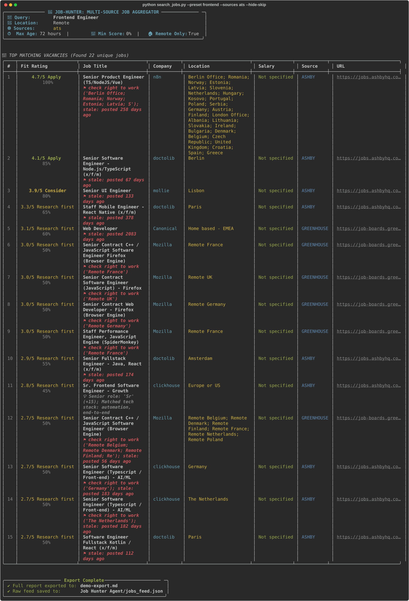
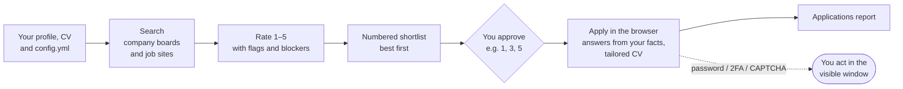

<div align="center">

# Job-Hunter

**Your AI job-search assistant. It finds vacancies for your profession, rates each one against your profile and applies only to the jobs you approve. Everything runs on your own computer.**

[](https://github.com/lasha-kvara/Job-Hunter/actions/workflows/tests.yml)
[](CHANGELOG.md)
[](https://www.python.org/downloads/)
[](https://claude.com/claude-code)
[](#installation)
[](LICENSE)

**English** · [ქართული](README.ka.md)

[Features](#features) · [How it works](#how-it-works) · [Installation](#installation) · [Every time you come back](#every-time-you-come-back) · [First search](#first-search-and-first-application) · [Command line](#command-line-no-ai) · [FAQ](#faq) · [Docs](#documentation)

</div>

You describe yourself once: your profile, your CV and where you can work. Job-Hunter then scans company career pages and job boards, rates every vacancy from 1 to 5 and shows you a numbered shortlist. It fills in and submits **only the applications you approve**, and it keeps a report of everything it sent. A second agent reads your LinkedIn recruiter messages, drafts replies for you to approve and schedules interviews in your time zone.

It runs inside [Claude Code](https://claude.com/claude-code) on your own computer. Search and rating also work as plain Python, with no AI account.

<details>
<summary><b>See a real search</b> (terminal output)</summary>
<br>
<p align="center">
  
</p>
</details>

---

## Features

| | |
|---|---|
| **Any profession** | 11 ready presets: QA automation, frontend, backend, full-stack, mobile, DevOps, data engineer, data analyst, ML engineer, product designer and product manager. You can add your own. [Presets →](presets/README.md) |
| **Any country** | You set where you live and which regions you can work for. Jobs you could never take are filtered out: remote "US only" roles, roles that need a security clearance, on-site jobs abroad without relocation. |
| **~200 company boards** | Reads Greenhouse, Ashby, Lever, SmartRecruiters and Recruitee directly (no login, no CAPTCHA, about 30 seconds). Also searches LinkedIn, Indeed, Glassdoor, ZipRecruiter, Google Jobs and jobs.ge. |
| **Honest 1–5 rating** | Every job gets a verdict: Apply, Consider, Research first or Skip. Flags mark blockers and postings that are stale, reposted or vague. |
| **A CV for each vacancy** | Your master CV is reordered and reworded for each job, then fact-checked against the master so no new facts appear. You get a designed PDF and an ATS-friendly PDF. [CV guide →](docs/cv.md) |
| **Recruiter assistant** | Reads LinkedIn threads, drafts replies in the recruiter's language and proposes interview slots in your time zone. It sends only what you approve. |
| **You stay in control** | Nothing is sent until you approve it. Passwords, 2FA codes, CAPTCHAs and online tests are always done by you. |
| **No made-up answers** | The agent answers only with facts you wrote down. If a form asks for something missing, it asks you. It never guesses. |
| **Private by default** | Your profile, CV, settings and history stay on your disk and are ignored by Git. No telemetry, no Job-Hunter server. [Privacy →](docs/privacy.md) |

## How it works



| Verdict | Rating | Meaning |
|---|---|---|
| **Apply** | 4.0 or more | Strong fit, no blockers |
| **Consider** | 3.5 – 3.9 | Fits, with some gaps |
| **Research first** | 2.5 – 3.4 | Location, tech stack or legitimacy is unclear |
| **Skip** | below 2.5, or a blocker | Not shown in the shortlist |

**Blockers:** remote work limited to regions you can't work in, a required work authorization or security clearance, on-site work abroad without relocation, or a job you already applied to. Old, reposted or very vague postings lose points. The full rules are in [scoring.md](.claude/skills/job-hunter-agent/references/scoring.md).

---

## Quick start

Already have Python 3.10+, Git, Node.js 18+ and Claude Code installed? Then (use `python3` instead of `python` on macOS and Linux):

```bash
git clone https://github.com/lasha-kvara/Job-Hunter.git
cd Job-Hunter
python init.py
claude
```

In Claude Code, say **"set up my profile"**. New to the terminal? Follow the step-by-step [Installation](#installation) below.

## Installation

> [!NOTE]
> **About 15–20 minutes, one time only.** You do not need to know how to program. You will type a few commands into a terminal, the text window where you type commands. Copy each command exactly as shown and press <kbd>Enter</kbd>.

<details>
<summary><b>How do I open and use a terminal?</b></summary>

- **Windows:** press <kbd>Win</kbd>, type `PowerShell` and press <kbd>Enter</kbd>. Windows Terminal also works.
- **macOS:** press <kbd>Cmd</kbd> + <kbd>Space</kbd>, type `Terminal` and press <kbd>Enter</kbd>.
- **Linux:** press <kbd>Ctrl</kbd> + <kbd>Alt</kbd> + <kbd>T</kbd>, or open "Terminal" from your apps menu.

**Paste** a command with <kbd>Ctrl</kbd> + <kbd>V</kbd>, or right-click if that does nothing (macOS: <kbd>Cmd</kbd> + <kbd>V</kbd>). **Stop** a running command with <kbd>Ctrl</kbd> + <kbd>C</kbd>. **Leave Claude Code** by typing `/exit`.

</details>

### Step 1 · Install the prerequisites

| Tool | Version | Why you need it | Download |
|---|---|---|---|
| **Python** | 3.10 or newer | Runs the setup, search and rating scripts | [python.org/downloads](https://www.python.org/downloads/) |
| **Git** | any recent | Downloads Job-Hunter and keeps it up to date. Claude Code also uses it | [git-scm.com/downloads](https://git-scm.com/downloads) |
| **Node.js** | 18 or newer (LTS) | Runs the browser that Claude Code uses to fill in forms | [nodejs.org](https://nodejs.org/) |
| **Claude Code** | latest | The AI agent that searches, applies and talks to recruiters. Needs a paid Claude plan (Pro or Max) or an Anthropic API account | [claude.com/claude-code](https://claude.com/claude-code) |

Install them **in this order**: Python, Git, Node.js, then Claude Code.

> [!IMPORTANT]
> **Python on Windows:** if you see the classic installer, tick **"Add python.exe to PATH"** on the first screen before you click *Install Now*. If python.org gives you the **Python install manager** instead, just accept its prompts. Either way, check it afterwards in a new terminal (below).

- **Windows:** the default options are fine for Git and Node.js.
- **macOS:** install Python from python.org, because the version that comes with macOS is often too old. If Git is missing, typing `git --version` offers to install the Command Line Tools; accept.
- **Linux:** install Python, `python3-venv` and Git with your package manager (on Debian/Ubuntu: `sudo apt install python3 python3-venv python3-pip git`). Take Node.js from [nodejs.org](https://nodejs.org/), since distribution packages are often older than 18.

**Install Claude Code** with the official one-line installer (check [claude.com/claude-code](https://claude.com/claude-code) for the current command):

Windows (PowerShell):

```powershell
irm https://claude.ai/install.ps1 | iex
```

macOS / Linux:

```bash
curl -fsSL https://claude.ai/install.sh | bash
```

Alternative, if you prefer npm (needs Node.js): `npm install -g @anthropic-ai/claude-code`.

**Check the installation.** Close and reopen the terminal so it finds the new programs, then run these. Each one should print a version number.

Windows (PowerShell):

```powershell
python --version
git --version
node --version
claude --version
```

macOS / Linux:

```bash
python3 --version
git --version
node --version
claude --version
```

**You should see** Python 3.10 or newer and Node.js v18 or newer.

> [!TIP]
> On Windows, if `python` opens the Microsoft Store or says "not found", try `py --version`. If that works, type `py` wherever this guide says `python` until [Step 4](#step-4--activate-the-environment); after that the project environment provides `python`.

### Step 2 · Download Job-Hunter

Go to your home folder and download the project:

```bash
cd ~
git clone https://github.com/lasha-kvara/Job-Hunter.git
cd Job-Hunter
```

**You should see** `Cloning into 'Job-Hunter'...` followed by `done`. The project is now in:

- **Windows:** `C:\Users\YourName\Job-Hunter`
- **macOS / Linux:** `~/Job-Hunter` (for example `/Users/yourname/Job-Hunter`)

Remember this path. Your terminal is now inside the `Job-Hunter` folder; run every other command in this guide from here.

> [!WARNING]
> **Avoid OneDrive, iCloud or Dropbox folders.** On many Windows PCs, Desktop and Documents are synced by OneDrive. A synced folder uploads thousands of setup files, can lock them during installation, and copies your personal files to the cloud. The home folder is the safe choice.

### Step 3 · Run the setup wizard

Windows:

```powershell
python init.py
```

macOS / Linux:

```bash
python3 init.py
```

The wizard prints 8 stages, `[1/8]` to `[8/8]`. Each stage skips itself if it is already done:

| Stage | What it does |
|---|---|
| `[1/8]` | Checks that Python is 3.10 or newer |
| `[2/8]` | Creates a private Python environment in `.venv` |
| `[3/8]` | Installs the required packages |
| `[4/8]` | Downloads the Chromium browser (used for CV PDFs and live checks), then copies your personal templates: profile, screening playbook, applications report, LinkedIn pipeline |
| `[5/8]` | Asks **8 short questions** and writes your `config.yml`, plus a master CV template in `my-cv/` |
| `[6/8]` | Writes `.mcp.json`, which connects Claude Code to the browser |
| `[7/8]` | Creates `.env` from `.env.example` (all keys in it are optional) |
| `[8/8]` | Runs the health check (`doctor.py`) |

**The 8 questions.** The default is shown in `[brackets]`; press <kbd>Enter</kbd> to accept it. Before question 1 the wizard prints the list of professions.

1. Your profession (preset), for example `frontend`, `devops` or `data-analyst`
2. Your full name (used for your CV file name)
3. The country you live in
4. Cities in that country to treat as home
5. The language the agents should talk to you in (`en`, `ka`, `de`, `uk`, ...)
6. Your UTC offset, for example `4` for GMT+4 or `-5` for GMT-5. Not sure? Search the web for "my UTC offset" and use your current one.
7. The UTC offsets you can work with, for example `1..7`
8. Whether you are open to relocation if the employer offers it

> [!IMPORTANT]
> **Do answer questions 1, 2, 3 and 6.** Their defaults (`qa-automation`, `Firstname Lastname`, `Georgia`, `0`) are only examples. You can change every answer later in `config.yml`, or redo the questions with `python init.py --force-config` (the old file is kept as `config.yml.bak`).

**You should see** a `✓` (done or kept) or `+` (new file created) under each stage, then the health check and a **Next steps** list. The health check marks each line:

| Icon | Meaning |
|---|---|
| `✓` | Works |
| `!` | Works, but something optional is missing. The line says how to fix it. |
| `✗` | Will not work until fixed. The line says how. |

The health check ends with `✓ Ready.` or `✓ Ready. (N optional items)`. On a fresh install some `!` lines are normal: your profile and master CV still hold the example content until Step 5. If it ends with `✗ Some checks failed.`, fix the `✗` lines and run `init.py` again.

- A `!` next to **Chromium** is not serious, because searching still works. Retry later with `python -m playwright install chromium` from the activated environment ([Step 4](#step-4--activate-the-environment)).
- A `!` next to **Node.js (npx)** means Claude Code cannot open the browser. Install Node.js 18+, reopen the terminal and run `init.py` again.

> [!TIP]
> `init.py` **never overwrites** files you already have, so it is safe to run again. To skip the questions entirely, run `python init.py --yes --preset frontend` (with your own preset).

### Step 4 · Activate the environment

Job-Hunter's packages live in the `.venv` folder. Turn it on before you run any `python` command yourself.

Windows (PowerShell):

```powershell
.venv\Scripts\activate
```

macOS / Linux:

```bash
source .venv/bin/activate
```

**You should see** `(.venv)` at the start of the prompt. From now on, `python` works the same way on every system.

> [!WARNING]
> **Windows: "running scripts is disabled on this system"?** PowerShell blocks scripts by default. Run this once, answer `Y`, then run the activate command again:
>
> ```powershell
> Set-ExecutionPolicy -Scope CurrentUser -ExecutionPolicy RemoteSigned
> ```
>
> This setting also lets the `claude` command start if you installed it with npm. If you would rather not change it, use Command Prompt with `.venv\Scripts\activate.bat`, or skip activation and call the project's Python directly, for example `.venv\Scripts\python.exe doctor.py`.

> [!IMPORTANT]
> Activate **once in every new terminal window**, after you `cd` into the project ([Every time you come back](#every-time-you-come-back)). Without it, Python cannot find the installed packages and you get a `ModuleNotFoundError` or the health-check warning "not in a virtual environment". Claude Code itself does not need it: it is told to use the project environment.

### Step 5 · Tell Job-Hunter about yourself

The agents answer forms and recruiters **only** from facts you give them, so this step matters most. Have your current CV ready, ideally as a **PDF**.

#### Option A: let Claude Code interview you (recommended)

1. From the `Job-Hunter` folder, start Claude Code:

   ```bash
   claude
   ```

2. **First run only:** pick a colour theme, then sign in to your Claude account in the browser window that opens.
3. When asked whether you **trust the files in this folder**, answer **Yes**. Otherwise the agents and their rules are not loaded.
4. When asked about the **MCP servers from `.mcp.json`**, choose the option that enables all of them: **`playwright`** and **`playwright-headless`**. They are the browser the agents work in.
5. Type `/mcp` to check. Both servers should show as **connected**. If you declined them, enable them there. If one shows **failed**, Node.js is missing or too old (see [troubleshooting](docs/troubleshooting.md)).
6. Now type:

   > **set up my profile**

   The agent asks for your CV file. To give its location:
   - **Windows:** in File Explorer, hold <kbd>Shift</kbd>, right-click the file, choose **Copy as path**, then paste it into Claude Code.
   - **macOS / Linux:** drag the file into the terminal window.

   It reads the CV, then asks only what a CV cannot tell it, for example target roles, country and city, time zone, relocation, work authorization, notice period, minimum salary, years per skill, links and the language for replies. It fills in your profile, screening playbook and `config.yml`, shows you a summary to confirm and corrects anything you change.

7. Then fill your **master CV**, which tailored CVs are built from. Say:

   > **put my CV into my-cv/CVindex.html**

   and then **"render my master CV"** (it runs `python cv_tools.py master` and makes the PDFs). See [docs/cv.md](docs/cv.md).

> [!NOTE]
> **Claude Code asks before it runs a command or changes a file.** Read each request. Running `python doctor.py`, `search_jobs.py` or `cv_tools.py`, and editing your profile, playbook, `config.yml` or CV files, is expected. If you are unsure, choose **No** and ask it why.

#### Option B: fill in the files yourself

Open them with **Notepad** (Windows) or **TextEdit** in plain-text mode (macOS). They are inside the `Job-Hunter` folder:

| File | What goes in it |
|---|---|
| `Linkedin Agent/candidate-profile.md` | Your facts: experience, skills, salary, contacts, CV path |
| `Job Hunter Agent/screening-playbook.md` | Ready answers for common application-form questions |
| `my-cv/CVindex.html` | Your master CV. Easiest: ask Claude Code *"put my CV into my-cv/CVindex.html"*. To edit by hand, follow [docs/cv.md](docs/cv.md) so the layout keeps working |

#### Check that everything is filled in

Run the health check again, in either way:

- **Inside Claude Code:** say **"run the health check"**.
- **In the terminal:** type `/exit` to leave Claude Code, then in the activated window ([Step 4](#step-4--activate-the-environment)) run:

  ```bash
  python doctor.py
  ```

**You should see** `✓ Ready.` with fewer optional items than before, and the **Master CV** line should show your name instead of the example. Add `--online` to also test that the job-board APIs can be reached.

### Every time you come back

> [!TIP]
> A new terminal always opens in your home folder, not in the project. Each time:
>
> 1. Open a terminal.
> 2. Go to the project: `cd ~/Job-Hunter` (Windows PowerShell: `cd $HOME\Job-Hunter`).
> 3. Type `claude` to use the agents, **or** activate the environment ([Step 4](#step-4--activate-the-environment)) to use the command-line tools.
>
> Starting `claude` outside the project folder means it does not load Job-Hunter's agents, rules or browser.

---

## First search and first application

### Search

In Claude Code, ask in your own words, in any language:

> **Find remote jobs that fit me**

The first time, the agent asks whether to use a **visible** (headed) or a **background** (headless) browser. **Choose visible the first time.** A separate browser window opens. It is not your normal browser and is not signed in anywhere. When the agent asks, sign in to LinkedIn (and any job site) in that window yourself, then type **done**. Both modes share one browser profile, so background mode reuses these sign-ins afterwards.

The agent then searches, rates every job and shows a numbered shortlist, one line per job: number, company, title, location and work mode, rating and verdict (for example `4.3/5 Apply`), how you apply (Easy Apply or the company's own application system) and at most two flags.

### Apply

1. **Approve the shortlist.** Reply with the numbers you want:

   > **Apply to 1, 3 and 4**

   This one message is your approval. The agent fills in and submits **exactly those** applications, without asking again for each one, and never more than you approved. It checks your report first, so it does not apply twice to the same job.

2. **Help when asked.** The agent pauses and tells you when:
   - a form needs a fact that is not in your profile or playbook. Answer it, and add it to the file so you are not asked again;
   - a site wants a password, a 2FA or e-mail code, or a CAPTCHA. Do it yourself in the **visible browser window**, then type **done**;
   - a site wants a new account, a payment or an online test, or the page does not match the shortlist.

3. **Read the report.** Every processed job is logged in `Job Hunter Agent/job-applications-report.md`, with its status, the answers given, the salary stated and the CV used.

### Other things you can ask

| You say | What happens |
|---|---|
| *"Search company boards only and show Apply / Consider jobs"* | A quick, focused shortlist |
| *"Search as a devops preset this time"* | Uses a different profession for one search |
| *"Check my LinkedIn messages"* | Reads recruiter threads and drafts replies for your approval |
| *"Schedule the interview with the recruiter from Acme"* | Proposes slots in your time zone and confirms only after you agree |
| *"What did I answer about salary at Acme?"* | Looks it up in your report |
| *"Add these companies to my boards: jobs.ashbyhq.com/acme"* | Adds them to your private board list |

More prompts and the full rules: [docs/claude-code.md](docs/claude-code.md).

> [!IMPORTANT]
> **What the agents never do:** type passwords or 2FA codes, solve CAPTCHAs, create accounts or take online tests for you; invent experience; apply beyond the shortlist you approved; send a recruiter message or confirm an interview you have not approved.

---

## Command line (no AI)

Search, rating and the LinkedIn pipeline also work as plain Python, with no AI account. Go to the project folder and activate the environment first ([Step 4](#step-4--activate-the-environment)).

```bash
python search_jobs.py --sources ats --hide-skip           # company boards only, about 30 s
python search_jobs.py --preset devops --min-rating 3.5    # another profession for one run
python search_jobs.py --query "Senior SDET" --no-remote --sources jobs_ge indeed
python search_jobs.py --list-presets                      # show all professions
```

Results appear as a table in the terminal and are saved to `search_results.md` and `Job Hunter Agent/jobs_feed.json`.

> [!TIP]
> A plain `python search_jobs.py` uses every source in your config (all seven by default, including LinkedIn and Indeed), which takes much longer. `--sources ats` is the fast option.

<details>
<summary><b>All <code>search_jobs.py</code> options</b></summary>

| Option | Default | What it does |
|---|---|---|
| `--preset NAME` | from `config.yml` | Profession preset for this run |
| `--list-presets` | | Lists the presets and exits |
| `--query`, `-q` | the preset's `default_query` | Search keywords for job sites |
| `--sources`, `-s` | `search.sources` in config (all seven in `config.example.yml`) | `ats`, `indeed`, `linkedin`, `google`, `glassdoor`, `zip_recruiter`, `jobs_ge` |
| `--hide-skip` | off | Leaves out Skip verdicts |
| `--min-rating` | 0 | Leaves out jobs rated below this (1–5) |
| `--min-score` | 45 | Leaves out jobs whose keyword fit is below this (0–100) |
| `--remote` / `--no-remote` | remote | Remote jobs only, or also on-site and hybrid |
| `--location`, `-l` | `Remote` (all locations with `--no-remote`) | Location used on job sites |
| `--country` | `USA` | Country for Indeed |
| `--limit`, `-n` | 10 | Results per job site |
| `--hours` | 72 | Job sites: only jobs posted in the last N hours |
| `--ats-days` | 0 (all) | Company boards: only jobs posted in the last N days |
| `--export-md` | `search_results.md` | Where to save the Markdown report |

</details>

| Other tools | Command |
|---|---|
| Health check | `python doctor.py` (`--online` also tests a job-board API, `--json` prints JSON) |
| CV PDFs from your master | `python cv_tools.py master`; tailored copies with `build`, fact check with `check` ([docs/cv.md](docs/cv.md)) |
| LinkedIn pipeline manager (terminal menu) | `python "Linkedin Agent/run.py"` (optional AI drafts with a Gemini key, see [configuration](docs/configuration.md)) |

---

## Make it yours

Settings come in three layers, and each one overrides the one before: `config.example.yml` (every key, documented), then the profession preset in `presets/`, then your own `config.yml` (git-ignored, written by `init.py`).

| What you want to change | Where |
|---|---|
| Profession | `preset:` in `config.yml` · [presets/README.md](presets/README.md) |
| Country, cities, regions you can or can't work for, time zone, language | `config.yml` · [docs/configuration.md](docs/configuration.md) |
| Facts about you | `Linkedin Agent/candidate-profile.md` |
| Answers to screening questions | `Job Hunter Agent/screening-playbook.md` |
| Your CV (master, tailored copies, PDFs) | `my-cv/CVindex.html` or `cv.dir` · [docs/cv.md](docs/cv.md) |
| Companies to scan | `Job Hunter Agent/ats-boards.local.json` (yours) · [docs/job-sources.md](docs/job-sources.md) |

## Privacy and safety

Everything personal stays on your computer and is ignored by Git: `config.yml`, `.mcp.json`, `.env`, your profile, playbook, CV folder, applications report, LinkedIn pipeline and search results. Data leaves your computer only to the job sites you search and apply on, and to the AI you use (Claude Code, and Gemini if you turn on LinkedIn drafts). If you keep the project in a cloud-synced folder, those files are synced too. Details: [docs/privacy.md](docs/privacy.md).

> [!WARNING]
> Automating job sites, especially LinkedIn, may break their terms of service and can get an account restricted. Keep volumes at a human pace, review what is sent, and use the tool at your own responsibility.

## FAQ

<details>
<summary><b>Can I use it without Claude Code or any AI?</b></summary>

Partly. Search, rating and the LinkedIn pipeline manager work as plain Python ([Command line](#command-line-no-ai)). Filling in forms, tailoring CVs and recruiter conversations are done by the Claude Code agents.

</details>

<details>
<summary><b>Where are my browser logins stored?</b></summary>

In `~/.playwright-job-hunter`, a browser profile shared by the visible and background modes and separate from your normal browser. Delete that folder to sign out everywhere.

</details>

<details>
<summary><b>My profession or country isn't listed.</b></summary>

Copy the closest file in `presets/` to `presets/<name>.yml`, edit it, and set `preset: <name>` ([presets/README.md](presets/README.md)). Countries need no code: set `home_country`, `home_places` and your regions in `config.yml` ([docs/configuration.md](docs/configuration.md)).

</details>

<details>
<summary><b>The search finds nothing, or too many jobs are "region-locked".</b></summary>

Run with `--min-score 0` and without `--hide-skip`. The **Flags** column then shows why each job was filtered out. If too many jobs are region-locked, your `locked_regions` may include the place where you live. See [docs/troubleshooting.md](docs/troubleshooting.md).

</details>

<details>
<summary><b>LinkedIn shows hybrid or on-site jobs under "Remote".</b></summary>

LinkedIn ignores its own remote filter. The agent checks the work mode on each job page itself, so trust its verdict rather than the filter.

</details>

<details>
<summary><b>How do I update Job-Hunter?</b></summary>

In the project folder run `git pull`, then `python init.py` again. It installs anything new and keeps all your files. What changed: [CHANGELOG.md](CHANGELOG.md).

</details>

<details>
<summary><b>Something else doesn't work.</b></summary>

Activate the environment and run `python doctor.py`: every `!` or `✗` line says how to fix it. Common problems (Python not found, `npx` missing, a broken `config.yml`, SSL errors on corporate networks, garbled characters in the Windows console) are covered in [docs/troubleshooting.md](docs/troubleshooting.md). Still stuck? Open an issue with the output of `python doctor.py --json`, with anything personal removed.

</details>

## Documentation

| Guide | Covers |
|---|---|
| [Claude Code](docs/claude-code.md) | The agents, the browser setup, a typical session, prompts and rules |
| [Configuration](docs/configuration.md) | Every `config.yml` key, environment variables, examples |
| [CV](docs/cv.md) | Master CV, tailored copies, the fact check, designed and ATS PDFs |
| [Job sources](docs/job-sources.md) | Where jobs come from, adding company boards and new sources |
| [Presets](presets/README.md) | The 11 professions and how to tune or add one |
| [Privacy](docs/privacy.md) | What stays local, what leaves, terms of service |
| [Troubleshooting](docs/troubleshooting.md) | Common problems and fixes |

<details>
<summary><b>Project layout</b></summary>

```text
init.py / doctor.py           setup wizard and health check
search_jobs.py                search + rating CLI
cv_tools.py                   tailored CV per vacancy, fact check, designed + ATS PDFs
cv/master.example.html        master CV template (copied to my-cv/, git-ignored)
config.example.yml            all settings, documented (your copy: config.yml, git-ignored)
presets/                      profession presets
CLAUDE.md, .claude/skills/    Claude Code rules and the two agents (job-hunter, linkedin)
Job Hunter Agent/
  aggregator/                 engine, sources (ATS boards, JobSpy, jobs.ge), scorer, assessment, settings
  ats-boards.json             company boards to scan
  *.template.md               report and screening-playbook templates
Linkedin Agent/               recruiter pipeline CLI, profile parser, reply drafts, templates
docs/                         guides
test_regression.py            test suite (no network, no personal files)
```

</details>

## Contributing

Contributions are welcome, especially ones that need little code: **company boards** (one line in `ats-boards.json`), **profession presets**, **local job sites** for your country, and **docs or translations**. Read [CONTRIBUTING.md](CONTRIBUTING.md), then run the tests from the activated environment with `python test_regression.py`. CI runs them on Ubuntu and Windows with Python 3.10 and 3.12. Release notes: [CHANGELOG.md](CHANGELOG.md).

## Acknowledgements

- [career-ops](https://github.com/career-ops-hq/career-ops) (MIT) inspired the 1–5 rating, the verdicts and the legitimacy signals.
- [Playwright MCP](https://github.com/microsoft/playwright-mcp) provides the browser the agents work in.
- [python-jobspy](https://pypi.org/project/python-jobspy/) searches LinkedIn, Indeed, Glassdoor, ZipRecruiter and Google Jobs.

## License

[MIT](LICENSE)
